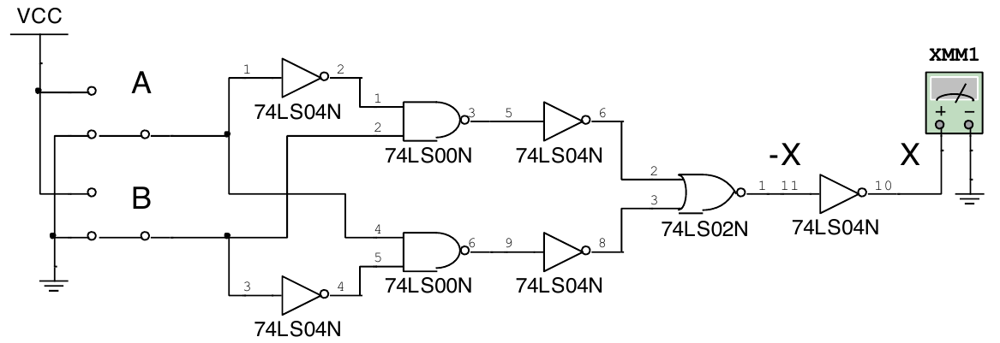
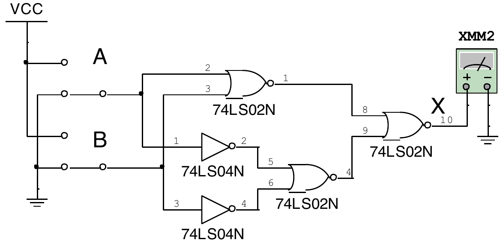
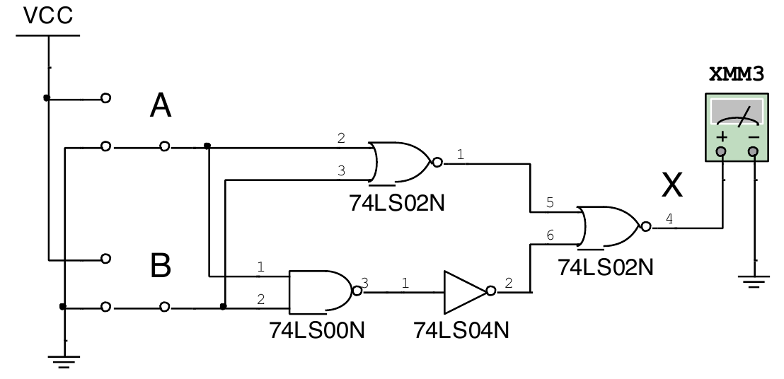
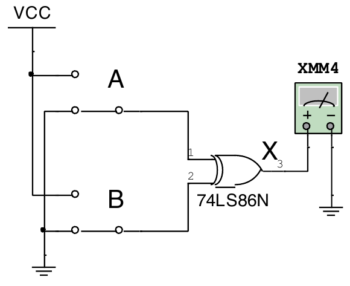
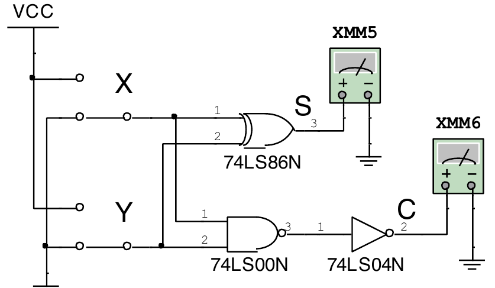
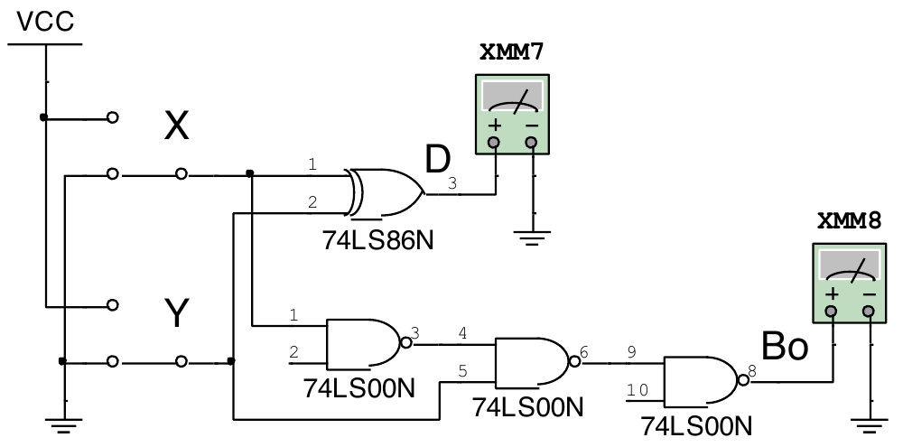
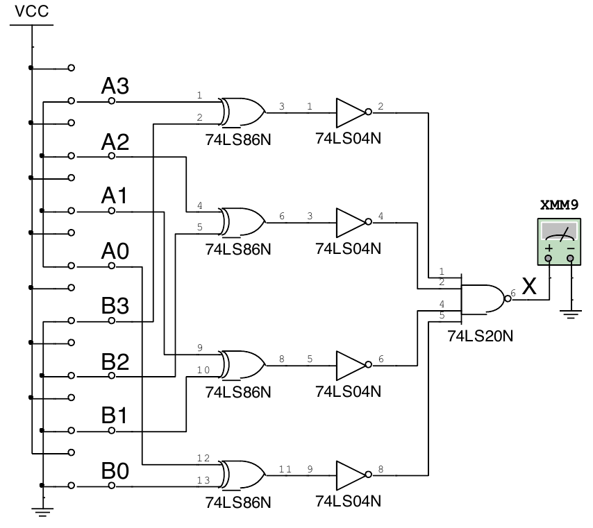
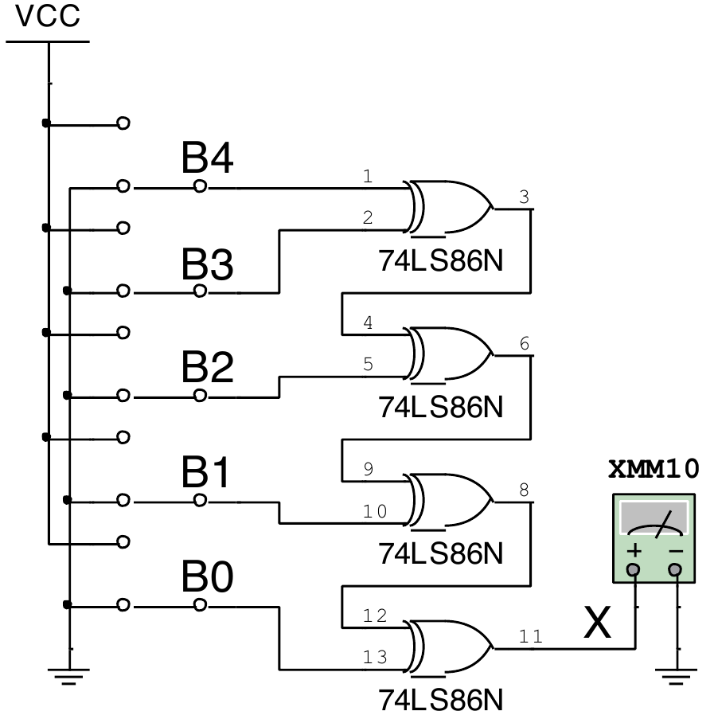

# Experiencia 04: Compuerta O exclusivo y aplicaciones

**Universidad de la Costa · Sistemas Digitales.** Adaptación fiel al PDF proporcionado por el docente.

- [PDF original completo, 8 páginas](guia-original-lab-04-xor-aplicaciones.pdf)
- [Informe interactivo con descarga de tablas y respuestas](informe-lab-04-xor-aplicaciones.html). En GitHub, pulse **Download raw file**, guárdelo y ábralo en un navegador. Las imágenes están incluidas y funciona sin conexión.

## Introducción y objetivos

La XOR entrega 1 cuando los dos bits son diferentes: **X = A·¬B + ¬A·B**. La guía estudia implementaciones de XOR, medio sumador, medio sustractor, comparador binario y generador de paridad. Los circuitos B y C se conservan como ampliación opcional en el tercer corte.

## Seguridad, recursos y preparación

- Apague la fuente antes de modificar conexiones. Respete límites de voltaje y corriente y evite componentes calientes. Use gafas y bata.
- Materiales: IC 7400, 7402, 7404, 7420 y 7486, cables y protoboard. Equipos: fuente CD y multímetro.
- Identifique los terminales con la hoja de datos de cada referencia completa. Verifique la alimentación antes de conectar VCC.
- El procedimiento utiliza entradas a 0 V y +5 V. Revise compatibilidad, conexiones y GND. Mida las salidas respecto de tierra.
- Monte los circuitos 1 a 5. Simule A, B y C y adjunte al menos una captura de cada uno.

## Procedimiento y tablas

Los espacios vacíos corresponden a **voltajes medidos**. El informe interactivo añade referencias teóricas separadas, cálculos y un campo para medir X en la tabla 7. Bo es préstamo; B0 es el bit de menor peso.

### Circuito 1 · XOR y salida complementaria

Construya el circuito de la figura 1. Registre los voltajes de X̄ (salida negada) y X respecto de tierra para las cuatro combinaciones.

Figura 1, página 3 del documento original.

**Tabla 1. Medición de voltaje (V).**

| A | B | X̄ (negada) | X |
| --- | --- | --- | --- |
| 0 | 0 |  |  |
| 0 | +5 |  |  |
| +5 | 0 |  |  |
| +5 | +5 |  |  |

### Circuito 2 · XOR con NOR e inversores

Construya el circuito de la figura 2. Mida el voltaje de salida X para cada combinación.

Figura 2, página 3 del documento original.

**Tabla 2. Medición de voltaje (V).**

| A | B | X |
| --- | --- | --- |
| 0 | 0 |  |
| 0 | +5 |  |
| +5 | 0 |  |
| +5 | +5 |  |

### Circuito 3 · XOR con NOR, NAND e inversor

Construya el circuito de la figura 3 y registre X. Explique por qué esta combinación de compuertas implementa XOR.

Figura 3, página 4 del documento original.

**Tabla 3. Medición de voltaje (V).**

| A | B | X |
| --- | --- | --- |
| 0 | 0 |  |
| 0 | +5 |  |
| +5 | 0 |  |
| +5 | +5 |  |

### Circuito 4 · XOR con 74LS86

Implemente la XOR del integrado 74LS86 según la figura 4. Mida X y compare su tabla con los circuitos anteriores.

Figura 4, página 4 del documento original.

**Tabla 4. Medición de voltaje (V).**

| A | B | X |
| --- | --- | --- |
| 0 | 0 |  |
| 0 | +5 |  |
| +5 | 0 |  |
| +5 | +5 |  |

### Circuito 5 · Medio sumador

Construya el medio sumador de la figura 5. Registre S (suma) y C (acarreo). La rama NAND seguida de NOT implementa AND.

Figura 5, página 5 del documento original.

**Tabla 5. Medición de voltaje (V).**

| X | Y | S | C |
| --- | --- | --- | --- |
| 0 | 0 |  |  |
| 0 | +5 |  |  |
| +5 | 0 |  |  |
| +5 | +5 |  |  |

### Circuito A · Medio sustractor

Simule la figura 6 y registre D (diferencia) y Bo (préstamo de salida) en la tabla 6, que continúa en la página 6 del PDF. Adjunte una captura de la simulación.

Figura 6, página 5 del documento original.

**Tabla 6. Medición de voltaje (V).**

| X | Y | D | Bo |
| --- | --- | --- | --- |
| 0 | 0 |  |  |
| 0 | +5 |  |  |
| +5 | 0 |  |  |
| +5 | +5 |  |  |

### Circuito B · Comparador binario

Configure A3…A0 según cada fila. Ajuste experimentalmente B3…B0 hasta obtener X < 0,5 V y registre B. Se añade una columna para guardar el voltaje X que comprueba esa condición. Adjunte una captura.

Figura 7, página 6 del documento original.

**Tabla 7. Medición de voltaje (V).**

| A3 | A2 | A1 | A0 | B3 | B2 | B1 | B0 |
| --- | --- | --- | --- | --- | --- | --- | --- |
| 0 | 0 | 0 | 0 |  |  |  |  |
| 0 | +5 | +5 | 0 |  |  |  |  |
| +5 | +5 | +5 | 0 |  |  |  |  |
| 0 | 0 | 0 | +5 |  |  |  |  |
| +5 | 0 | +5 | 0 |  |  |  |  |

### Circuito C · Generador de paridad

Simule la cascada de XOR de la figura 8 y registre X para las ocho combinaciones de la tabla. Adjunte una captura y explique el sentido de la paridad obtenida.

Figura 8, página 7 del documento original.

**Tabla 8. Medición de voltaje (V).**

| B4 | B3 | B2 | B1 | B0 | X |
| --- | --- | --- | --- | --- | --- |
| 0 | 0 | 0 | 0 | 0 |  |
| 0 | +5 | 0 | +5 | 0 |  |
| +5 | 0 | +5 | 0 | +5 |  |
| 0 | +5 | +5 | +5 | 0 |  |
| +5 | +5 | 0 | +5 | +5 |  |
| +5 | 0 | +5 | +5 | +5 |  |
| 0 | +5 | 0 | 0 | 0 |  |
| 0 | 0 | 0 | 0 | +5 |  |

## Análisis y cálculos

Compare teoría y medición. Para los circuitos 1 a 5, identifique las mediciones más cercanas y más alejadas de la referencia y explique las posibles causas.

**E% = |(VR − VE) / VE| × 100**, con VR medido y VE estimado. Cuando VE = 0 V, el porcentaje no está definido: reporte **|VR − VE|** en voltios. Los niveles ideales 0/5 V no sustituyen las especificaciones eléctricas del CI.

## Cuestionario

1. Explique cómo los circuitos 1, 2 y 3 cumplen la función XOR. Demuestre mediante ecuaciones booleanas, leyes y reglas del álgebra de Boole y teoremas de De Morgan.
2. Explique el medio sumador y el medio sustractor. ¿Cuál es la diferencia con un sumador completo y un sustractor completo?
3. Explique la operación del comparador binario del circuito B simulado. Si es necesario, escriba la tabla de verdad.
4. Explique la operación del generador de paridad del circuito C simulado.
5. ¿Para qué se utiliza un generador de paridad? ¿Cuál paridad es preferible, par o impar? Justifique según la aplicación.

## Entrega

Informe con tablas, cálculos, análisis, capturas, conclusiones y aporte de cada integrante. En el interactivo puede descargar cada tabla o todas en CSV, guardar el informe HTML con respuestas e imágenes, respaldar/restaurar JSON e imprimir o guardar PDF.

## Referencias del documento original

- Boylestad, R. L. y Nashelsky, L. (2012). *Electrónica: Teoría de circuitos y dispositivos electrónicos*. Pearson.
- Hayt, W. H., Kemmerly, J. E. y Durbin, S. M. (2012). *Análisis de circuitos en ingeniería*. McGraw-Hill.
